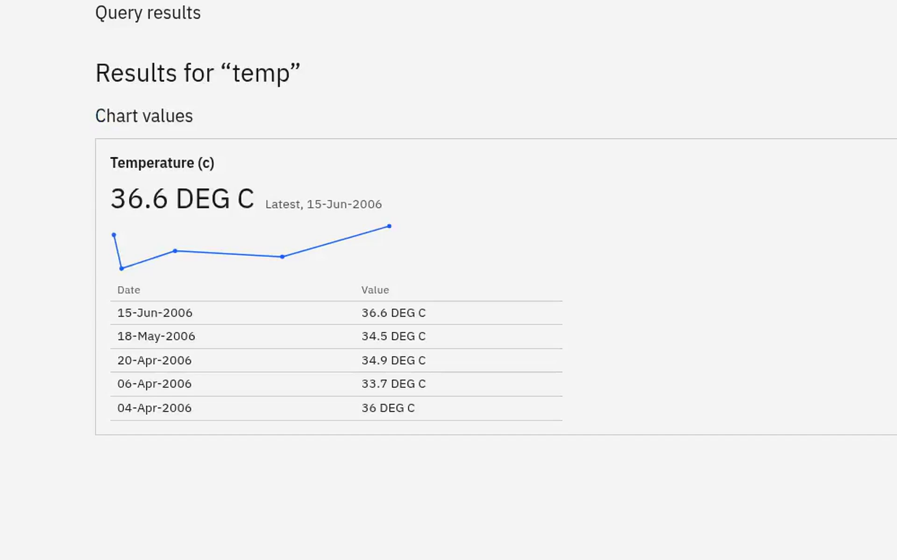

# esm-omnibar-app

A contextually-aware “omnibar” for OpenMRS 3: one always-visible field where users simply ask the EMR for what they want. Summon it from anywhere with Ctrl K (⌘K on Mac), or with `/` for a command.

**Status:** prototype, running live on an O3 3.8.0-rc.2 sandbox at [o3.pgb.md](https://o3.pgb.md/openmrs/spa), where you can try it yourself: log in as `demo` with the password `Omnibar1!`. It type-checks, lints, builds and passes its unit tests.

To illustrate how other O3 ESM apps plug in, I've adapted three of them on my own forks and branches, as worked examples of the contract rather than finished features: the [Cohort Builder](https://github.com/pbiondich/openmrs-esm-cohortbuilder-app) answers population questions with a count row, [ChartSearch](https://github.com/pbiondich/openmrs-esm-chartsearchai) answers clinical questions on the Query results page, and a [super simple results viewer leveraging query store](https://github.com/pbiondich/openmrs-esm-querystore-app) looks up chart values from an index. Each registers a provider or a view from its own `routes.json`; none of it is upstream yet, and the omnibar itself is naive to all of them.

## Demo

[Watch the walkthrough](docs/media/demo.mp4) (59 seconds). The same cut is a [GIF](docs/media/demo.gif), and the shot list is in [docs/media/demo-script.md](docs/media/demo-script.md).



## Why

Today, the O3 user experience is mouse- and application-oriented. You find a patient, then click through the app to get what you want. That's hardly unique to OpenMRS: most EMRs have spent decades building sophisticated interfaces that try to anticipate how users will want to reach their data, and every new need becomes another screen, tab or menu.

In the age of AI, I think it's worth stepping back and reconsidering what an EMR is and how it should work. My gut tells me that we should build the next generation of OpenMRS UX around a simple presumption:

**A user can simply ask the EMR for what they want, rather than navigate an interface to find it.**

There are very few places in O3 today to ask an open-ended question. The most natural pattern for that kind of interaction is a prompt box: ie, a browser address bar, or a LLM chat prompt. OpenMRS actually has one, but it's hidden behind a magnifier icon and is only used today to look up patients.

I propose we unbridle that prompt! Let's borrow the [omnibar that browsers adopted years ago](https://www.digitaltrends.com/computing/history-of-google-chrome/), let users simply ask for what they're after, and use contextual clues to interpret those requests intelligently. The most important clue is where the user is. Inside a patient's record, the most likely questions are about that patient: "cd4" means their latest CD4 count, and "when did she start ART?" means her history. Outside a patient record, the same box is more likely being used to find a patient ("Mary Achieng") or to ask a question about a population ("women aged 15-49 enrolled in HIV").

Asking doesn't necessarily mean that everything has to go through a language model. Many requests can be answered directly and deterministically, for example from the concept dictionary's names and synonyms, and anything generated has to show the records it came from. The omnibar is deliberately not a chatbot, and nothing typed into it changes the record.  There's lots of experimentation that we'll have to do, to get this right!

This is a prototype of an O3 omnibar. :)

## What it does

A few scenarios, to make the idea concrete. **Built** means the code exists, and most of it is running on the sandbox; **Planned** means it's designed but not built yet. Where a capability comes from one of the example apps above, the table says so: the omnibar itself is a shell, and the apps that own the data provide the answers (see [How it's built](#how-its-built)).

### Outside a patient record

| You type | You get | Status |
| --- | --- | --- |
| nothing yet | Recently viewed patients. | Built |
| `Mary Achieng`, or an ID | Matching patients, plus a link to the full search page. | Built |
| `how many women aged 15-49 enrolled in HIV?` | A count row: "Counting…", then "1,204 patients", with what was counted in the Cohort Builder's own words underneath. Enter opens the Cohort Builder with the same definition, ready to refine. It reads a phrase table (age groups like "women of reproductive age", comparators, number words) and the server's own program and encounter-type names, so "enrolled in HIV care" works without config. A question it can't fully read gives no row rather than a wrong number. | Built, in the Cohort Builder's app |
| `women with latest weight > 70` | A count row for patients by a numeric test result, alone or with gender and age, using the latest value. | Built, in the Cohort Builder's app |
| `patients over 40 on ART` | The same, once the Cohort Builder's drug-order criterion is live on the server. | Building |
| `how do I print labels?` | An answer from a knowledge base. | Planned |

### Inside a patient record

A chip with the patient's name sits in the field, so it's always clear whose record the question is about.

| You type | You get | Status |
| --- | --- | --- |
| `cd4`, `hb`, `latest weight`, `show vitals` | The latest value and date for each matching concept, in your language. Choosing one opens the results viewer. | Built |
| `cd4`, then Enter | **Query results**: every CD4 value with its date and a trend line, as a section of the chart. | Built |
| `when did she start ART?`, then Enter | Query results, where ChartSearch answers the question with citations. The bar's hint says it will ("Enter to ask ChartSearch…") before you press Enter; typing alone never asks a model. | Built, in ChartSearch's app |
| a name or an ID | Other patients, listed below anything from this chart. A scanned wristband ID opens its patient directly. | Built |

### Query results

Pressing Enter on a query, rather than choosing a suggestion, opens a section of the patient chart called **Query results**. It sits in the left nav alongside the existing dashboards, so the rest of the chart stays a click away, and the URL (`/patient/<uuid>/chart/query-results?q=cd4`) means the back button and bookmarks work.

- **Enter submits; choosing opens.** A quiet line at the foot of the list says so ("Enter to see all results for 'cd4'"). Arrow to a row, or point at one, and Enter opens that row instead. Outside a chart, Enter opens the highlighted row as before.
- **The view depends on the question.** `cd4` shows the values the query names, not a general results viewer. A question also brings ChartSearch's answer, streaming in with its citations and any safety findings. Reloading the page never asks again by itself; a button does.
- **This visit's questions are kept, per patient.** Choosing one runs it again, so results are never stale. The list never appears in another patient's chart, and it clears at logout, which matters on shared clinic workstations.
- **Other apps add sections.** Each is a view registered in `omnibar-query-results-slot`, just as providers register in the bar.
- *Planned:* a condensed patient banner once the full one scrolls away, the medication timeline for ART questions, the BP trend for `blood pressure`, and pinned queries that follow you from chart to chart. In time, a dashboard could simply be a query someone pinned in advance.

### Slash commands

Typing `/` states the kind of query up front instead of leaving the omnibar to infer it. Commands are optional; plain text always works.

| You type | What it means | Comes with |
| --- | --- | --- |
| `/patient Mary Achieng` | Find a patient. | the omnibar |
| `/lab cd4` | CD4 as a lab result, never a patient whose name matches. | the omnibar |
| `/go ward` | Open a page. | the omnibar |
| `/cohort women aged 15-49 enrolled in HIV` | A population question. Outside a chart only; inside one it's listed greyed out. | the Cohort Builder's app |
| `/ask when did he start ART?` | A question for ChartSearch rather than something to look up. | ChartSearch's app |
| `/help printing labels` | Search the knowledge base. | *Planned* |

`/` on its own lists the commands; a chosen one becomes a chip, and Backspace or Escape takes it off. Each command has a stable id and any number of aliases, so `/labs`, `/results` and `/obs` all mean `/lab`, a translation can add names in another language, and a site can add its own (`/vl` for viral load). A command that doesn't apply where you are, like `/lab` outside a chart, is listed greyed out with the reason. The full design is in [`docs/design/slash-commands.md`](docs/design/slash-commands.md).

### Everywhere

The field is visible in the header on desktop. On tablet and phone it's a field-shaped button that opens a full-screen search (this still feels too buried to me atm tbh!). Implementations that prefer today's collapsed magnifier can keep it with one line of config. Arrow keys move through results, Enter opens one, Escape closes. When a provider offers completions, they show as a strip under the field, with the first one as grey text after what you've typed: Tab takes it, Escape hides the strip, and a click or tap takes any of them. A completion only fills in the field; it never opens anything or asks a model.

## How it's built

### A light omnibar

The omnibar is a thin shell, and capabilities live in the ESM apps that own/understand the data. The omnibar shell knows nothing clinical: it owns the header field and the tablet and phone sheet, the scope (`global` or `patient`, decided only by the host), ranking and the keyboard, the standard patient row, and the provider contract. Nothing in its source names ChartSearch, the Cohort Builder or the query store.

Every capability is a **provider**: an ordinary O3 extension, registered in `omnibar-providers-slot`, that renders nothing. While the panel is open, the shell mounts the providers that declare the current scope and passes each one the debounced `query`, the `context` (scope, patient, locale, the open side panel) and a `report` function. The provider calls `report` whenever it has something to say. Because providers are extensions, they get lazy loading, privilege gating, feature flags, config and translations from the existing framework for free, and nothing new is asked of esm-framework. Query results works the same way: each section is a **view** registered in `omnibar-query-results-slot`.

### Design rules

These rules are what make it safe to let many teams contribute to one search box. Changing any of them should be a deliberate, discussed decision, not a side effect of a feature.

1. **Results describe destinations; they don't act.** A result's target is a URL or a workspace launch. There is no `onSelect` callback, so the normal way to build a provider has no path to write to the record. Anything that changes data opens a form or workspace, where the usual checks apply.
2. **The shell owns the scope.** Providers receive the patient; they can't choose it. Changing charts clears everything on screen, so a query never runs silently against the wrong patient.
3. **Lanes, not a merged ranking.** Results group into `record`, `navigate` and `answer` lanes, then by each provider's declared order. Scores from different providers aren't comparable, so the shell doesn't pretend they are.
4. **Stale results are dropped.** Every report carries the query it answers, so a slow reply to `cd` can't overwrite results for `cd4`.
5. **Answers must cite records.** A finished answer with no sources is hidden, with a note saying why.
6. **Show early, act late.** The bar can suggest anything, but it acts only when the user picks a result or presses Enter, and then only by going somewhere. Typing never calls a model. A model runs only when the clinician asks: by pressing Enter on a question inside a chart, which the bar's hint names beforehand, or by pressing Send in the tool that owns the model.

Rule 1 is a convention set by the contract's shape, not a sandbox, so the host also guards against a provider's mistakes: inside a chart, a result that names another patient never takes the default highlight and a workspace launch for another patient is refused, and a target to another origin is refused. The one exception, owned by the host, is a scanned wristband ID, which opens the one patient the built-in patient search finds. See [what the host guards against](docs/design/omnibar-provider-contract.md#what-the-host-guards-against).

### The provider contract

This is contract version 1. Everything another app needs is in [`src/omnibar-contract/`](src/omnibar-contract/): the types and a few helpers. Apps copy that folder as it is, and copy it again only when the omnibar bumps the major version. The heart of it is one call:

```ts
interface OmnibarProviderProps {
  query: string;
  context: { scope: 'global' | 'patient'; patientUuid?: string; locale: string; /* … */ };
  report: (r: OmnibarReport) => void;
}

interface OmnibarReport {
  query: string; // reports for any other query are dropped
  status: 'idle' | 'loading' | 'ready' | 'error';
  title: string; // group heading, translated by the provider
  results?: Array<{ id: string; title: string; subtitle?: string; target: OmnibarTarget }>;
  answer?: { text: string; streaming: boolean; sources: Array<{ label: string; target: OmnibarTarget }> };
}
```

`meta` in `routes.json` declares the lane, the scopes, the order, the contract version and, optionally, a slash command. The full contract, including dedupe, the default highlight, versioning and the order and command registries, is in [`docs/design/omnibar-provider-contract.md`](docs/design/omnibar-provider-contract.md).

### What comes with the omnibar, and what other apps add

The omnibar ships three providers and one view as defaults for now (see [`src/routes.json`](src/routes.json)); they're expected to move to their owning apps later.

| In this repo | Lane | Scopes | Command | Data source |
| --- | --- | --- | --- | --- |
| Patient search | record | global, patient | `/patient` | REST `/patient?q=`; recents from the `patientsVisited` user property |
| Chart lookup | record | patient | `/lab` | REST `/concept?q=` on the query minus filler words ("latest", "show"), then FHIR `Observation/$lastn` for the latest value per concept |
| Destinations | navigate | global, patient | `/go` | Config: label, path, keywords, optional privilege |
| Chart values view | — | patient | `/lab` | Every value for each concept the query names, from FHIR `Observation?code=…` |

| From other apps | What it adds | Where it lives |
| --- | --- | --- |
| Cohort Builder | The count row and `/cohort`, outside a chart | Local branches of the Cohort Builder fork; the URL hand-off is [proposed upstream](docs/upstream/) |
| ChartSearch | The answer section on Query results and `/ask` | ChartSearch's own app, which declares `asksModel` so the bar's hint can name it |
| Query store | Chart values from the query store's index instead of, or beside, chart lookup | [`openmrs-esm-querystore-app`](https://github.com/pbiondich/openmrs-esm-querystore-app), its own repo |

Each of those registers from its own `routes.json` on its own copy of the contract folder; installing the app is the switch, and the omnibar has no code or config that names it. When an app's server can't be reached, its group shrinks to its heading and "Unavailable right now".

The full design, including how O3's current search works and why each decision was made, is in [`docs/design/omnibar-concept.md`](docs/design/omnibar-concept.md), and the dated decisions since are in [`docs/decisions.md`](docs/decisions.md).

## How to use

### Trying it in a distribution

Add `@openmrs/esm-omnibar-app` to the distribution's SPA build (it needs `webservices.rest` ≥ 2.2.0 and `fhir2` ≥ 1.2 on the server), then remove the old search icon. Slot config belongs to the module that renders the slot, which here is the navigation app:

```json
{
  "@openmrs/esm-primary-navigation-app": {
    "extensionSlots": {
      "top-nav-actions-slot": { "remove": ["patient-search-icon"] }
    }
  }
}
```

The patient search app keeps working; its `/search` page is where "All patient results" goes.

Destinations are config, because every distribution has different apps and different words for them. Check the default paths against your build and add the words your staff use:

```json
{
  "@openmrs/esm-omnibar-app": {
    "destinations": [
      { "label": "Service queues", "path": "${openmrsSpaBase}home/service-queues", "keywords": ["triage", "waiting"] },
      { "label": "Lab orders", "path": "${openmrsSpaBase}home/laboratory", "keywords": ["lab", "tests"], "privilege": "Get Orders" }
    ]
  }
}
```

Other settings worth knowing:

- `appearance: "icon"` keeps today's collapsed magnifier instead of a visible field. In either mode the control carries `data-tutorial-target="search-patient-icon"`, so existing onboarding tutorials still point at the right thing.
- `commands` adds, replaces or disables command aliases by id, for example `{ "id": "lab", "aliases": ["vl", "viral"] }`.
- `queryResults.enterBehavior: "open-highlight"` makes Enter inside a chart open the highlighted row, as it did before Query results, so the two can be compared. `queryResults.maxValuesPerConcept` (default 50) and `queryResults.questionMinWords` (default 3) tune the page and the "and ask…" hint.
- `patientSearch.*` and `chartLookup.*` tune the two built-in providers. The full schema, with descriptions, is in [`src/config-schema.ts`](src/config-schema.ts).

To have the query store answer chart lookups instead of the built-in provider, install the query store app and remove chart lookup from the slot with `"omnibar-providers-slot": { "remove": ["omnibar-chart-lookup-provider"] }`. ChartSearch's answer section is configured in ChartSearch's app.

### Writing a provider

Any app can add results by registering one extension. Here is a lab-orders provider from another module:

```tsx
const LabOrdersProvider: React.FC<OmnibarProviderProps> = ({ query, context, report }) => {
  const { t } = useTranslation();
  const { data, isLoading } = useActiveLabOrders(context.patientUuid, query);

  useEffect(() => {
    report({
      query,
      title: t('labOrders', 'Lab orders'),
      status: isLoading ? 'loading' : 'ready',
      results: data?.map((order) => ({
        id: order.uuid,
        title: order.display,
        target: { type: 'navigate', to: `\${openmrsSpaBase}patient/${context.patientUuid}/chart/Orders` },
      })),
    });
  }, [query, context, data, isLoading, report, t]);

  return null;
};
```

It registers in its own `routes.json`, where `meta` declares the lane, the scopes it runs in, its order and the contract it was built for:

```json
{
  "name": "lab-orders-omnibar-provider",
  "component": "labOrdersOmnibarProvider",
  "slot": "omnibar-providers-slot",
  "privileges": ["Get Orders"],
  "meta": { "lane": "record", "scopes": ["patient"], "order": 20, "contract": 1 }
}
```

Copy [`src/omnibar-contract/`](src/omnibar-contract/) into the app for the types and `withProviderBoundary`, wrap the provider in it in `index.ts`, and pick an order from the [registry](docs/design/omnibar-provider-contract.md#order-registry). A Query results view is written the same way, with `withViewBoundary`, and registers in `omnibar-query-results-slot`.

### Developing

```sh
yarn install --immutable
yarn start                                           # dev server, against dev3.openmrs.org by default
yarn start --backend http://localhost:8080/openmrs   # or against a local backend
yarn test                                            # vitest only, while iterating
yarn verify                                          # lint, type-check, and tests with coverage
yarn build                                           # production build into dist/
```

To work on the omnibar and another app together, give the dev server both folders: `yarn start --sources . --sources ../openmrs-esm-querystore-app`. Build tooling comes from [openmrs-esm-template-app](https://github.com/openmrs/openmrs-esm-template-app). The Playwright scaffolding in `e2e/` comes from the template too; there are no omnibar end-to-end tests yet.

## Where it's going

The aim is to prove this outside core and then bring it to the OpenMRS community. So far: the prototype runs on [o3.pgb.md](https://o3.pgb.md/openmrs/spa) with its first live fixes in; Query results and slash commands are built; the Cohort Builder, ChartSearch and the query store each plug in from their own app, and the omnibar no longer knows any of them by name.

Next:

1. Take it to the patient-management squad, with patient search as the first provider and the `appearance` option ready.
2. Add a dedicated centre slot to the navbar in esm-primary-navigation-app, since `top-nav-actions-slot` is crowded.
3. Finish Query results in the chart: the condensed sticky patient banner, and the vitals header only where it earns its space.
4. Finish slash commands: the inferred-command chip ("searching as /lab"), and `/help` from a knowledge-base app.
5. Try the query store live, and settle when a chart should be indexed.
6. Grow cohort questions: drug criteria ("on ART"), bare program names ("HIV patients"), and handing complex questions to the Cohort Builder.
7. Fix `PatientPhoto` in esm-styleguide to load only same-origin photos, then use it in patient rows again.
8. Move the slot and types into esm-framework through an RFC once the contract settles.

Open questions:

- Is REST `/concept?q=` fast enough for type-ahead on a full CIEL dictionary, and does it match synonyms and locale names as assumed?
- Should destinations come from config, or be derived from `routes.json` pages with people-facing labels added? How should their labels be translated?
- Can the results viewer accept a deep link to a specific test, so chart lookup lands on the value?
- How does CIEL represent drug groupings such as antiretrovirals, and can that seed drug groups for cohort questions?
- Does the tablet sheet work on real devices?

Questions that have been settled, and why, are in [`docs/decisions.md`](docs/decisions.md).

## Contributing

Read [AGENTS.md](AGENTS.md) before changing anything, whether you're a person or an agent. It covers the architecture rules, the contract conventions people most often get wrong, the review policy, how commits and pushes work, and how to verify a change. Check every change against the [design rules](#design-rules). The briefs given to agents are in [`docs/briefs/`](docs/briefs/), and every review round is logged in [`FIXES.md`](FIXES.md).

## License

[MPL 2.0](LICENSE)
